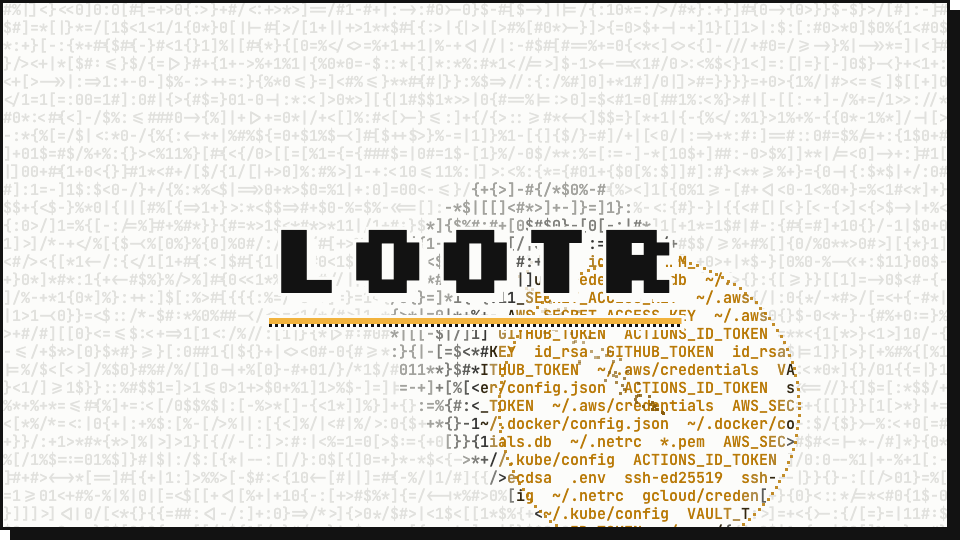

<picture>
  <source media="(prefers-color-scheme: dark)" srcset="docs/banner-dark.gif">
  
</picture>

# lootr

lootr shows what a process can reach with the rights of the current user when it runs without a
sandbox: SSH keys, cloud and registry credentials, tokens in environment variables and `.env`
files, CI workflow permissions, privilege-escalation paths. It does not stop at "this exists":
every artifact is interpreted into **facts** (`encrypted = false`, `bits = 2048`,
`kind = "classic"`), and a **policy** written in [CEL](https://cel.dev) decides what is
acceptable. The result is a report with location, type, severity and a remediation (JSON, SARIF for
GitHub code scanning, or Markdown for pull requests and job summaries) and an exit code for CI.

lootr is offline and read only: no network, no subprocesses, no writes except the report. It never
prints, stores or decrypts a secret value.

> Status: early development (milestone M7: release hardening), no release yet. The pipeline,
> layered config with locked rules and waivers, CEL policy and the JSON/SARIF/Markdown reports
> work end to end with SSH keys and PEM files, cloud credentials (AWS, Google Cloud, Azure CLI),
> kubeconfigs, Docker/npm/PyPI/netrc/git/gh credential files, GitHub Actions workflow
> permissions, GitHub/GitLab/AWS tokens, well-known API keys, JWTs, `.env` and other config files,
> the process identity and container runtime sockets, and (M6) privilege-escalation and
> lateral-visibility checks: readable environments of other processes (`/proc`), writable `PATH`
> directories, shared CI caches, shell rc files and git hooks, setuid/setgid binaries and file
> capabilities, the in-cluster Kubernetes service account token, and content scanning for embedded
> secrets. The release workflow (static,
> reproducible, attested binaries) is written but has not run yet, so the GitHub Action has
> nothing to download until the first tag. See [PLAN.md](PLAN.md).

## Documentation

- [docs/config-reference.md](docs/config-reference.md): `lootr.toml` (sources, types, extractors,
  rules, waivers, layering, locked rules) and every command line flag
- [docs/cel.md](docs/cel.md): the policy language, variables, `has(attrs.x)`, examples per type
- [docs/types.json](docs/types.json): every built-in type and its attributes (`lootr types
  --json`, kept in sync by `tests/docs.rs`)
- [docs/report-schema.md](docs/report-schema.md): JSON report, `--emit-facts`, SARIF mapping,
  Markdown, exit codes
- [docs/threat-model.md](docs/threat-model.md): what lootr protects, how, and the residual risks
- [docs/dependencies.md](docs/dependencies.md): dependency review record (`cargo vet`, licenses,
  `unsafe`)
- [docs/review-checklist.md](docs/review-checklist.md): checklist for the external review
  before 1.0

## How it works

```
 Source ──► Extractor ──► Type ──► Fact ──► Policy (CEL) ──► Finding ──► Report
 env, file,  dotenv, ...   github_token,  attributes   rules per type   + waivers   JSON / SARIF /
 probe                     ssh_key, jwt …                                            Markdown, exit code
 ───────────── collector: touches the system, sees secrets ─────────────   ──── pure functions ────
```

1. **Load config**: the built-in default layer, then every `--config` layer in order. Unknown
   types, CEL syntax errors and attributes that are not in the type's schema stop the run (exit 2)
   before anything is scanned.
2. **Discover**: env var names by glob, file paths by glob (`~` expanded, no symlinks followed,
   depth and size limits, one file system), probes.
3. **Collect**: files are opened securely and read into a wiped-on-drop buffer; types and
   extractors turn them into facts. Raw bytes never leave this stage.
4. **Evaluate**: the rules for each fact's type, then waivers; finally every waiver becomes a
   `waiver` fact, so rules can report expired or stale waivers.
5. **Report**: JSON, SARIF or Markdown on stdout (or `--output`), progress on stderr, exit code.

## Install and run

Releases (from the first tag on) are static Linux binaries (`x86_64`/`aarch64`, musl) and a
macOS universal binary, each with a Sigstore bundle holding its SLSA build provenance, plus
`SHA256SUMS` and a CycloneDX SBOM. Verify before unpacking:

```sh
gh attestation verify lootr-<v>-<target>.tar.gz --bundle lootr-<v>-<target>.tar.gz.sigstore.json \
  --repo <owner>/lootr --signer-workflow <owner>/lootr/.github/workflows/release.yml \
  --source-ref refs/tags/v<v> --deny-self-hosted-runners
```

(or `cosign verify-blob-attestation`, see "Release artifacts" in [PLAN.md](PLAN.md)). Releases are
reproducible: at the tag, `LOOTR_SOURCE_DATE_EPOCH=$(git log -1 --format=%ct) nix develop
.#release -c scripts/release.sh build <target> dist` rebuilds an archive that must match
`SHA256SUMS` (the macOS one with the same Xcode version as the release runner).

From source, the toolchain comes from the Nix flake:

```sh
nix develop                  # shell with cargo, clippy, cargo-deny, cargo-audit, cargo-fuzz, cargo-vet
cargo build --release --locked  # ./target/release/lootr
```

```sh
lootr                                    # scan with the built-in default policy, JSON on stdout
lootr --config company.toml --config project.toml
lootr --fail-on medium --output report.json
lootr --format sarif --output lootr.sarif  # GitHub code scanning
lootr --format markdown --redact-paths   # for a PR comment or job summary
lootr --emit-facts                       # include every collected fact (for jq, OPA, ...)
lootr types                              # every type and the attributes rules can use (--json)
lootr explain ssh-key-unencrypted        # a rule after all config layers, with its type's attributes
lootr policy check company.toml project.toml  # validate config layers, scan nothing
```

| flag | meaning |
|------|---------|
| `--config <PATH>` | config layer after the built-in default (repeatable, later wins) |
| `--no-default` | do not load the built-in default config |
| `--fail-on <SEVERITY>` | exit 1 if an unwaived finding has at least this severity (default `high`) |
| `--format json\|sarif\|markdown` | report format (default `json`) |
| `--output <FILE>` | write the report to a file (created with mode 0600, never through a symlink) instead of stdout |
| `--emit-facts` | include all facts in the report (JSON only) |
| `--redact-paths` | hide paths outside the working directory (`~/<redacted:1>`), also on stderr |
| `--summary-only` | only counts by severity and rule: no findings, locations or facts |
| `-q`, `--quiet` | only warnings and errors on stderr |

Exit codes: `0` no unwaived finding at or above `--fail-on` (or the subcommand succeeded), `1` such
findings, `2` error (invalid config, a rule that failed to evaluate, I/O error, unknown rule for
`explain`, `--emit-facts` with another format than JSON).

`lootr policy check [FILES]` loads the built-in default (unless `--no-default`), every `--config`
and then `FILES`, validates everything and prints the layers, locked rules and waivers (with days
until they expire; expired ones are warnings). It reads nothing but the config files: no
environment, no home directory (`~` in waiver paths is expanded against a placeholder), no scan.
Use it in the CI of a policy repository.

## Reports

All formats are built from the same report model, so they show the same findings and paths.
Only facts reach a report; no format can contain secret material.

- **JSON** (default, `schema_version` 1): run info, custom types, summary (counts by severity and
  by rule), findings with rule, severity, message, remediation, tags, waiver and the fact,
  rule errors, expired waivers, skipped files. The shape is documented in
  [`src/report/json.rs`](src/report/json.rs).
- **SARIF 2.1.0** (`--format sarif`) for GitHub code scanning: every enabled rule as rule metadata
  (message template, condition, remediation, `security-severity`, tags as `key/value`), levels
  from severity (critical/high `error`, medium `warning`, low/info `note`), waived findings as
  accepted suppressions, rule errors and expired waivers as notifications. Files below the working
  directory get repository-relative URIs (`%SRCROOT%`); other files absolute `file://` URIs; env
  vars, key paths and probes are logical locations.
- **Markdown** (`--format markdown`) for pull request comments and job summaries: the result, a
  table by severity (unwaived and waived), findings grouped by severity with remediation and tags,
  waived findings with reasons, expired waivers, rule errors, skipped files (collapsed). Every value
  from the scan or config is a code span, so a key named `@org/team` or a JWT issuer
  `https://...` cannot become a mention or a link.

Paths:

- Paths below the home directory are always shown as `~/...` (`run.home` keeps the absolute home
  so tools can expand it). Rules, waivers and CEL always see absolute paths.
- `--redact-paths` keeps paths in the working directory (the project, shown as `./relative`) and
  replaces all others by numbered placeholders, `~/<redacted:1>` or `<redacted:2>` (the same path
  keeps its number within a report); `run.home` and `run.cwd` become `<redacted>`. When the working
  directory is `/`, the home directory or above it, every path is redacted. Text from the config
  (waiver globs, message templates) is not redacted.
- `--summary-only` drops findings, locations and facts and keeps the counts (JSON `summary` with
  `by_rule`, the SARIF run's `properties.summary` without `results`, the Markdown summary table).

`--emit-facts` adds `facts` to the JSON report: every collected fact
(`{"type", "location", "source", "attrs"}`, the attributes of `lootr types --json`) plus one
`waiver` fact per configured waiver, for tools that want to decide themselves:

```sh
lootr --emit-facts | jq '.facts[] | select(.type == "ssh_private_key" and .attrs.encrypted == false) | .location.path'
lootr --no-default --config sources-only.toml --emit-facts > facts.json   # collect facts, no rules
```

## What the default policy looks at

The built-in default config is an ordinary first layer (`--no-default` drops it; later layers can
override or disable any source or rule by id). It reads:

| source | what | type |
|--------|------|------|
| `process-env` | every environment variable | `env_var`, classified by the value types (`github_token`, `gitlab_token`, `aws_access_key_id`, `api_key`, `jwt`, custom types) |
| `ssh` | `~/.ssh/**` | `ssh_private_key` (files that are not keys are skipped) |
| `dotenv` | `./**/.env`, `./**/.env.*` (not in `.git/`, `node_modules/`) | `dotenv_entry`, classified like env vars |
| `pem` | `./**/*.pem`, `./**/*.key`, `~/.docker`, `~/.kube`, `~/.minikube` keys | `pem` |
| `aws`, `gcp`, `azure` | `~/.aws/{credentials,config}`, gcloud ADC and legacy credentials, `~/.azure/*.json` | `aws_credentials`, `gcp_credentials`, `azure_profile` |
| `kubeconfig` | `~/.kube/config`, `~/.kube/*.yaml` | `kubeconfig` |
| `docker-config` | `~/.docker/config.json`, `~/.config/containers/auth.json` | `docker_config` |
| `npmrc`, `pypirc`, `netrc`, `git-credentials`, `gh-hosts` | `~/.npmrc` and project `.npmrc`, `~/.pypirc`, `~/.netrc`, `~/.git-credentials`, `~/.config/gh/hosts.yml` | the type of the same name |
| `workflows` | `./.github/workflows/*.y{a,}ml` | `github_workflow` |
| `cargo-credentials`, `terraform-credentials`, `composer-auth`, `gem-credentials`, `yarnrc`, `gradle-properties` | tool credential files | `config_entry` (toml/json/yaml/ini extractors), classified like env vars |
| `process` | who lootr runs as | `process` |
| `container-sockets` | `/var/run/docker.sock`, containerd, Podman, BuildKit, Docker Desktop/Colima/Rancher sockets | `unix_socket` |
| `proc-environ` | environments of other processes (Linux `/proc`) | `proc_environ` (values classified like env vars) |
| `path-dirs`, `shared-caches` | `$PATH` entries and local bin dirs, shared CI caches (`~/.cargo/registry`, `~/.npm`, `~/.cache/pip`, tool caches) | `writable_path_dir` (only if writable by others) |
| `shell-rc`, `git-hooks` | shell rc files (`~/.bashrc`, `~/.zshrc`, …) and git hooks (`./.git/hooks/*`) | `writable_file` (only if others can write it or its directory) |
| `suid` | setuid/setgid binaries and file capabilities in local bin dirs | `suid_binary` |
| `kube-service-account` | `/var/run/secrets/kubernetes.io/serviceaccount/token` | `kube_service_account` (token classified → `jwt`) |
| `content` | source/config files (`./**/*.{rs,py,js,ts,go,java,rb,php,yml,yaml,json,tf,sh}`) | embedded secrets classified by the value types, at `file#L<line>` |

and reports, among others: unencrypted, readable-by-others, weak (DSA, RSA < 3072) and
legacy-encrypted SSH keys and private keys inside git work trees; classic GitHub tokens (high) and
other GitHub tokens; GitLab tokens; long-lived AWS access keys; well-known API keys; long-lived and
non-expiring JWTs; Google service account keys; Azure service principal secrets and token caches;
static tokens, embedded client keys and disabled TLS verification in kubeconfigs; credentials
stored in plain text in Docker, npm, PyPI, netrc, git and gh files (and those files readable by
others or committed); workflow jobs with `write-all`, writes on `pull_request_target` /
`issue_comment` / `workflow_run`, `packages: write`, or no `permissions:` at all; tokens and
secret-looking values in `.env` and config files that git does not ignore or that everybody can
read; secret-looking environment variables; running as root; membership in root-equivalent groups
(`docker`, `lxd`, `disk`) or admin groups; a root-owned container socket the user can use; expired
waivers. `lootr explain <rule>` shows each rule; every rule has a `category` tag.

What the types read (only non-secret parts):

- `ssh_private_key`: OpenSSH keys are decoded only up to the end of the public key (cipher, KDF,
  key type, size); PEM and PKCS#8 only header lines and the public start of the structure.
- `github_token`: prefix (`ghp_`, `github_pat_`, `gho_`, `ghu_`, `ghs_`, `ghr_`) and the built-in
  CRC32 checksum, which tells real tokens from examples (not whether a token is active).
- `jwt`: header and the registered claims `iss`, `aud`, `exp`, `iat`, `nbf`, `scope`/`scp`; the
  signature is never decoded. Issuer, audience and scopes appear in the report.
- `dotenv`: `KEY=value` entries (quotes, `export`, comments); values are classified like env vars.
- Credential files (`aws_credentials`, `gcp_credentials`, `azure_profile`, `kubeconfig`,
  `docker_config`, `npmrc`, `pypirc`, `netrc`, `git_credentials`, `gh_hosts`): counts and names
  (profiles, contexts, hosts) become facts; every stored token or password is handed to the value
  types as a nested value (base64 `auth` fields and percent-encoded passwords decoded into a wiped
  buffer), so a GitHub token in `.netrc` reports like one in `$GH_TOKEN`. A `credential_process`
  or exec plugin is counted, never run.
- `pem`: block labels; private keys are read like SSH keys (only the non-secret start).
- `github_workflow`: per job the effective `GITHUB_TOKEN` permissions (job-level replaces
  workflow-level; none at all = the repository default, which lootr cannot see) and the triggers.
- `gitlab_token`, `aws_access_key_id`, `api_key`: prefix, charset and length only (Slack, Stripe,
  OpenAI, Anthropic, npm, PyPI, Docker Hub, Google, SendGrid, Hugging Face, DigitalOcean, Shopify,
  Vault, Terraform Cloud, RubyGems; patterns credited in [THIRD_PARTY.md](THIRD_PARTY.md)).
- Extractors `ini`, `json`, `yaml`, `toml` (for your own file sources) turn every string value into
  a `config_entry` with a dotted key path, classified like an env var.
- The `content` extractor scans a file's text for embedded secrets: it tokenizes each line, hands
  every token to the value types and keeps only the ones a type recognized (`file.rs#L42`), so a
  hardcoded GitHub token in source code is reported like one in `$GH_TOKEN`. Binary files (a NUL in
  the first 8 KiB) are skipped; `max-file-size` applies.
- `proc_environ` (Linux) reports how many other processes' environments are readable and classifies
  their values, so another job's token on the same runner is found — read in memory only, like a
  file; the content never becomes a fact (only counts, the processes' names and the recognized
  secrets' *types*). `writable_path_dir` / `writable_file` judge writability from mode, owner and
  groups (never by writing); `suid_binary` reads setuid/setgid bits and Linux file capabilities
  (`security.capability` xattr); `kube_service_account` reads the in-cluster token (→ `jwt`) with its
  namespace and CA.
- YAML is parsed with depth, size and alias-expansion limits (an alias bomb is a parse error, not a
  hang); JSON and TOML parsers have nesting limits. Parser errors never quote the file.
- Files also get `in_git_repo` / `gitignored`: the nearest parent with `.git`, and the
  repository's `.gitignore` files and `.git/info/exclude` (read directly, no git process).

## Configuration: `lootr.toml`

One format for sources, custom types, rules and waivers. Unknown keys are errors.

```toml
version = 1

[scan]
max-file-size = "1MiB"
max-depth = 16
one-file-system = true
exclude = ["~/Library/**"]       # appended across layers

[[source]]
id = "process-env"
kind = "env"
names = ["*"]

[[source]]
id = "ssh"
kind = "file"
paths = ["~/.ssh/*"]
type = "ssh_private_key"         # a document type ...
# extract = "dotenv"             # ... or an extractor: dotenv, ini, json, yaml, toml

[[source]]
id = "sockets"
kind = "probe"
probes = ["unix_socket"]         # probes: process, unix_socket
paths = ["/var/run/docker.sock"] # paths for probes that inspect files (sockets)

[[type]]                         # custom value type: regex only
name = "acme_api_key"
pattern = '^acme_[A-Za-z0-9]{32}$'

[[rule]]
id = "acme-key-anywhere"
type = "acme_api_key"
when = 'true'
severity = "high"
message = "ACME key in {location}"
remediation = "Rotate the key and remove {name}"
tags = { internal = "SEC-12" }
locked = true                    # later layers may not disable, weaken or waive it

[[waiver]]
rule = "acme-key-anywhere"
path = "~/ci/**"                 # and/or: name = "ACME_KEY"
reason = "CI fixture, rotated weekly"
expires = 2027-01-31             # expired waivers are ignored and reported
```

- **Layers**: a later layer adds entries, overrides a source or rule by `id` (only the fields it
  sets; `tags` are merged key by key) or disables it with `enabled = false`. An override whose id
  no earlier layer defines is an error (typos must not pass silently). `include = ["base.toml"]`
  applies local files (relative to the including file) first. URLs are not supported.
- **Locked rules** (`locked = true`): later layers may raise the severity and change message,
  remediation and tags; disabling, unlocking, changing `type` or `when`, lowering the severity are
  config errors naming the file, the rule, the locking layer and every attempted change. Only the
  layer that locks a rule may waive it. A locked rule also locks its inputs against weakening:
  `[scan]`, custom types and every source that can produce its type may be extended but not
  disabled, repointed, excluded or limited by later layers; sources, custom types and `[scan]`
  can be locked explicitly too (`locked = true`). See [`examples/company/`](examples/company/)
  for a baseline, a team layer and project waivers.
- **Skipped entries**: what lootr selected but could not (fully) look at is reported under
  `skipped` with a reason (unreadable, too large, `binary`, `truncated`, `depth_limit`,
  `other_fs`, `symlink_root`, ...). `[scan] fail-on-skipped = ["truncated", ...]` (or `["*"]`)
  makes such entries fail the run (exit 1).
- **Waivers**: `rule` plus an optional `path` glob and/or `name` (env var name or key path inside a
  file), a `reason` and an optional `expires` date (UTC). Waived findings stay in the report with
  the reason and do not count for `--fail-on`. An expired waiver is ignored (the findings come
  back), listed under `expired_waivers`, warned about on stderr and reported as a finding of the
  default rule `waiver-expired`. Every waiver is also a `waiver` fact (`waived_rule`, `reason`,
  `expires`, `expired`, `expires_in_days`, `matched`, `waived_path`, `waived_name`), so a policy can
  demand expiry dates or flag waivers that matched nothing.
- **Tags**: free `key = value` pairs on rules, shown in every report format (e.g. internal control
  ids). Every default rule has a `category` (lootr's own, stable): `key-protection`,
  `key-strength`, `file-permissions`, `version-control`, `credential-exposure`,
  `long-lived-credential`, `plaintext-storage`, `transport-security`, `ci-permissions`,
  `privilege`, `policy-hygiene`.
- **Paths**: `~` is the home directory, relative paths are relative to the current directory.
  `*` and `?` stay within one path component (and match dotfiles), `**` matches any number of
  components, `[abc]` / `[!abc]` match one character.
- **Rules**: `when` is CEL over the fact's attributes plus `type`, `source` and `location`
  (`location.kind`, `location.path`, `location.key_path`, `location.name`). Optional attributes
  are tested with `has(attrs.name)`. A rule that fails to evaluate (e.g. type mismatch) is a
  `rule_error` and the run exits with 2; it never silently passes.
- **Placeholders** in `message` / `remediation`: `{path}`, `{name}`, `{type}`, `{rule}`,
  `{source}`, `{location}` and any attribute of the type (`{mode}` in octal, a missing optional
  attribute as `-`).

Every type has a schema (`lootr types`); facts from files also carry `mode`, `world_readable`,
`group_readable`, `owner_is_self`, `age_days`, `size`, `in_git_repo` and `gitignored`. Generic entries (`env_var`, `dotenv_entry`, ...) carry
`name`, `length`, `entropy` (estimated bits) and `classified_as`.

**Config is as trusted as code.** A policy runs with lootr's access to secret values (custom
patterns can act as an oracle). Review third-party policy packs like a dependency; custom types
are listed in the report header.

**Whoever can edit a layer controls it.** A `lootr.toml` (or a "baseline") checked into the
scanned repository is controlled by every pull request author: a PR can add waivers, disable
unlocked rules and sources, or drop the file from the workflow. Policy a PR must not be able to
weaken has to come from outside the repository (baked into the CI image or runner, or checked
out from a separate, reviewed policy repository at a pinned commit) and has to lock what it
enforces; the in-repository file is then only a later layer that can add rules and waive what is
not locked. The workflow that runs lootr must itself be one a pull request cannot
change (e.g. an organization ruleset's required workflow).

## CI

- **GitHub Actions**: [`action.yml`](action.yml) is a composite action. It downloads a lootr
  release by version, verifies its Sigstore build provenance (`gh attestation verify`, or `cosign`
  if `gh` is missing) before unpacking, runs lootr in the job (with `--redact-paths` by default),
  appends the Markdown report to the job summary and uploads SARIF to code scanning through the
  REST API (needs `security-events: write`; a failed upload, e.g. from a fork, is a warning). It
  uses no third-party actions; inputs reach its scripts only through the environment, and its
  token is never visible to lootr. Pin it by commit SHA:
  ```yaml
  - uses: OWNER/lootr@<commit SHA of tag vX.Y.Z> # vX.Y.Z
    with:
      version: X.Y.Z
      config: |
        ${{ runner.temp }}/policy/baseline.toml   # checked out from the policy repository
        lootr.toml
  ```
  Config files inside the checkout (`lootr.toml`, `.github/lootr/*.toml`) and their waivers are
  under the control of the pull request being scanned. Load the company baseline from outside
  the checkout (a pinned checkout of a policy repository, the runner image) and lock the rules it
  enforces; see "Whoever can edit a layer controls it" above.
  Inputs: `version` (required), `repository`, `config`, `fail-on`, `args`, `redact-paths`,
  `sarif`, `sarif-category`, `job-summary`, `token`, `working-directory`; outputs: `exit-code`,
  `sarif-file`, `markdown-file`.
- Complete examples: [`examples/ci/github-actions.yml`](examples/ci/github-actions.yml) and
  [`examples/ci/gitlab-ci.yml`](examples/ci/gitlab-ci.yml) (download, `cosign` verification,
  reports as artifacts).
- Release artifacts the action and the examples expect are listed in [PLAN.md](PLAN.md)
  ("Release artifacts") and produced by `.github/workflows/release.yml`, which also tests the
  action end to end against each new release. No release exists yet.

## Security

lootr runs where the secrets are, so the tool itself is hardened:

- **No secret in any output.** Facts have no plain string type; text from scanned data is only
  accepted through explicitly named `from_non_secret` constructors. Secret bytes live in a
  `SecretBuf` that cannot be printed, serialized or cloned and is zeroized on drop. A canary test
  runs every output mode and fails if any dummy secret appears.
- **Process hardening** before any file is opened: core dumps off; on Linux also
  `PR_SET_DUMPABLE = 0` (no ptrace by other processes of the same user).
- **Secure file access**: `O_NOFOLLOW | O_NONBLOCK | O_CLOEXEC`, `fstat` on the descriptor, only
  regular files are read, size checked before reading; symlinks, FIFOs, sockets and devices are
  reported by metadata only. Unreadable files are results, not failures.
- **No network, no subprocesses, no `unsafe`**: enforced with clippy (`clippy.toml`) and
  `cargo-deny` (`deny.toml` bans network and async crates).
- **Policy cannot hang**: CEL always terminates; regexes use the linear-time `regex` crate.

See [SECURITY.md](SECURITY.md) for reporting vulnerabilities.

### Honest limits

- Zeroizing is best effort. The process environment block, the kernel page cache and library
  internals may keep copies of secret bytes. lootr keeps exposure short and small, it cannot make
  it zero. Memory is not locked (`mlock`): secrets live for milliseconds, and it would need
  `unsafe`.
- `O_NOFOLLOW` protects the last path component; below a source's literal prefix the walk
  resolves each component with `openat` + `O_NOFOLLOW` (parent-symlink safe). One race remains:
  a symlink swapped into a parent directory *between* discovery and the (re-resolved) read in
  `collect`; it is re-resolved from the trusted prefix, so only that window is open.
- macOS has no unprivileged equivalent of `PR_SET_DUMPABLE`; only core dumps are disabled there.
- lootr never verifies a credential against its service, so it cannot know e.g. a token's
  scopes. Facts are what the bytes say.
- Root and the kernel can always read lootr's memory.
- `gitignored` considers the repository's ignore files only: not the global excludes file (it
  differs per machine) and not the index (a tracked file stays tracked even if it is ignored now).
- Group names come from `/etc/group` only (no NSS, LDAP or Open Directory lookups); unnamed groups
  are reported by number. Socket access is judged from mode, owner and groups, never by
  connecting.
- The GitHub token checksum follows GitHub's published format but has only been tested against
  generated dummies, never against a real token (the tests are offline). Other token formats are
  recognized by prefix, charset and length only; lootr verifies no other checksums.
- Parsers that unescape (JSON strings, YAML scalars) work in scratch buffers of their own crates,
  which lootr cannot wipe; lootr's own copies are wiped.
- Effective workflow permissions without any `permissions:` key depend on repository and
  organization settings lootr cannot read; such jobs are reported as `permissions_source =
  "repository"`.
- GitHub code scanning shows results that have a file in the repository; findings in env vars,
  the home directory or system paths are in the SARIF file (and the job summary) but not in the
  code scanning UI.
- `--redact-paths` hides paths, not everything: env var names, key paths inside files, rule
  messages built from attributes (a JWT issuer, a kube context name) and config text stay.
- The scan cannot tell which repository a path belongs to: SARIF treats the working directory as
  the repository root, so run lootr from the checkout's root.

## Development

```sh
nix develop -c cargo fmt --check
nix develop -c cargo clippy --locked --all-targets -- -D warnings
nix develop -c cargo test --locked
nix develop -c cargo deny check
nix develop -c cargo audit
nix develop -c cargo vet --locked  # dependency review state (docs/dependencies.md)
containers/run.sh                # container scenarios (podman or docker)
nix develop -c cargo fuzz run -s none ssh_key -- -max_total_time=60   # see the target list below
```

**Never run lootr on your own machine against your real home while developing**: it reads your
real `~/.ssh`, environment and credentials. Unit tests use in-memory fake repositories, the
canary integration test runs the binary with an empty environment and a temporary `HOME`, and
real environments (users, groups, file modes, sockets, `/proc`) are tested in containers:

- `containers/base/Containerfile` builds lootr in a Rust image and copies it into a slim Debian
  image (`lootr-base`);
- `containers/scenarios/<name>/Containerfile` sets up one environment `FROM lootr-base`, with an
  `expected.json`;
- `containers/run.sh [--update] [scenario...]` builds everything, runs lootr in each container
  without network, normalizes the report and diffs it; it also fails on the canary string. Every
  scenario also runs as SARIF, Markdown, with `--redact-paths` and `--summary-only` (same exit
  code, no canary, valid structure, no home directory in redacted output). Scenarios are built
  with the repository root as context (`company-policy` copies `examples/company/`); an optional
  `/usr/local/lib/lootr-scenario/args` hook appends arguments such as `--config` layers.

Fast fixtures without containers live in `test-envs/<group>/<name>/` (fake home, optional
`workdir/`, `env.toml`, optional `lootr.toml`, `expected.json`); `cargo test --test fixtures` runs
the binary against each in a temp dir and `LOOTR_UPDATE_FIXTURES=1` rewrites the expected reports
(review the diff). Dummy secrets are marked `dummy_*` / `DUMMY` and carry the canary
`LOOTRCANARY`; GitHub tokens are written as `{{github_token:<prefix>:<30 random chars>}}` and
get their valid checksum when the fixture is set up (containers use `gen-github-token`), so no
checksum-valid token is ever committed. Other well-known key formats are written as
`{{token:<prefix>:<rest>}}` and base64 auth fields as `{{base64:<a>:<b>}}`, so secret scanners never
see a whole dummy key in the repository.

Fuzzing uses `cargo fuzz` with the flake's stable toolchain: `-s none` runs libFuzzer without
AddressSanitizer (which needs nightly and adds little to a crate that forbids `unsafe`). Targets:
`ssh_key`, `jwt` (also GitHub tokens), `dotenv`, `yaml` (loader, yaml extractor, kubeconfig,
gh_hosts, github_workflow), `json` (json extractor, gcp, azure, docker), `ini` (ini extractor, aws,
pypirc, npmrc), `toml`, `lines` (netrc, git_credentials, pem), `values` (api_key, gitlab_token,
aws_access_key_id), `content` (the content scanner's line tokenizer).

Release builds: `nix develop .#release -c scripts/release.sh reproduce <target> dist` builds a
release archive twice (two source copies, two target directories) and fails unless both are
identical; targets `x86_64-unknown-linux-musl` and `aarch64-unknown-linux-musl` build on any host
(linked by `rust-lld`, no C toolchain), `universal-apple-darwin` needs macOS with Xcode. CI checks
the Linux builds on every push (`ci.yml`), fuzzes every target for 20 minutes nightly
(`fuzz.yml`); tags run `release.yml`.

The code is layered (see `src/lib.rs`): `domain` (model, types, no I/O) ← `repository` (all data
access, real and fake) ← `service` (the pipeline) ← `cli` / `report`; `os` holds the hardening and
secure open used by repository implementations.

## License

GPL-3.0-only, see [LICENSE](LICENSE). Anyone may use lootr, also commercially and on company
machines; distributed modifications must stay GPL. Dependencies are GPL-3.0-compatible (enforced by
`cargo-deny`).
